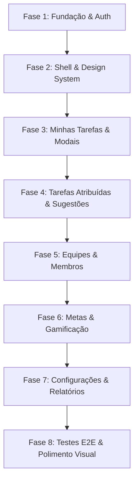

# 📑 Plano de Implementação: Cortex Front-End

Este documento estabelece o plano técnico e estrutural para a finalização e integração completa do **Cortex-frontend** (Next.js 16, React 19, TypeScript), garantindo conformidade rigorosa com os requisitos do **Charter do Projeto Cortex**, o **Design System (Guia de Estilo)** e os contratos da API **Cortex-backend**.

---

## 🎯 Sumário Executivo

- **Objetivo:** Transformar o protótipo inicial do frontend em uma aplicação web corporativa completa, robusta e responsiva, componentizada e totalmente integrada à API REST.
- **Fidelidade Visual:** Aderência estrita à paleta de cores (Roxo Brilhante `#7B4FC9`, Azul Escuro `#12192C`, Branco `#FFFFFF`, Cinza `#E5E5E5`, Verde `#134011`, Vermelho `#D63131`), tipografia Poppins e layouts prototipados nas seções 5 e 6 do Charter.
- **Arquitetura:** Next.js App Router, React Server/Client Components, CSS Modules, Context API para estado global de autenticação e tema, e camada de serviços HTTP com tipagem TypeScript estrita.

---

## 📊 Matriz de Rastreabilidade (Charter vs. Frontend)

| Requisito | Funcionalidade | Rota Front-End | Endpoint(s) Cortex-Backend | Modais / Subcomponentes |
| :--- | :--- | :--- | :--- | :--- |
| **RF001 / RN01 / RN02** | Autenticação & Cadastro | `/login`, `/registro` | `POST /api/auth/login`<br>`POST /api/usuario`<br>`GET /api/usuario/me` | Modal Verificação E-mail |
| **RF003 / RN06** | Minhas Tarefas | `/minhas-tarefas` | `GET /api/tarefa?responsavelId={id}`<br>`PATCH /api/tarefa/{id}/concluir` | `TaskTable`, `TaskCard` |
| **RF003** | Criação de Tarefas | Modal na tela de tarefas | `POST /api/tarefa` (multipart)<br>`POST /api/tarefa/{id}/responsaveis` | `TaskCreateModal` (Charter 6.1.2) |
| **RF003 / RF004 / RF008** | Visualização de Tarefa | Modal na tela de tarefas | `GET /api/tarefa/{id}`<br>`GET /api/tarefas/{id}/anexos` | `TaskDetailsModal` (Charter 6.1.2) |
| **RF004 / RN14** | Sugestões de Alteração | Integrado ao modal de tarefa | `POST /api/tarefas/{id}/sugestoes`<br>`PATCH /api/sugestoes/{id}/aprovar`<br>`PATCH /api/sugestoes/{id}/rejeitar` | `SuggestionModal` |
| **RF008** | Tickets de Reporte | Integrado ao modal de tarefa | `POST /api/tarefas/{id}/tickets` | `ReportTicketModal` |
| **RF003** | Tarefas Criadas (Atribuídas) | `/tarefas-atribuidas` | `GET /api/tarefa?criadorId={id}`<br>`PUT /api/tarefa/{id}`<br>`DELETE /api/tarefa/{id}` | `TaskEditModal` (Charter 6.2.1) |
| **RF009** | Gestão de Equipes | `/equipes` | `GET /api/equipe`<br>`POST /api/equipe` | `TeamCard`, `TeamCreateModal` (Charter 6.3.1) |
| **RF009 / RN03 / RN04** | Membros & Tickets da Equipe | `/equipes/[id]` | `GET /api/equipe/{id}/membros`<br>`POST /api/equipe/{id}/membros`<br>`DELETE /api/equipe/{id}/membros/{mId}`<br>`PATCH /api/equipe/{id}/membros/{mId}/cargo`<br>`GET /api/equipes/{id}/tickets`<br>`PATCH /api/tickets/{tId}/fechar` | `AddMemberModal` (Charter 6.3.3), `MemberTable`, `TeamTicketList` |
| **RF007 / RN07 / RN08 / RN15** | Metas & Gamificação | `/metas` | `GET /api/metas`<br>`POST /api/metas`<br>`PUT /api/metas/{id}`<br>`DELETE /api/metas/{id}` | `GoalCreateModal` (Charter 6.5.1), `GoalProgressBar` |
| **RF001 / RF005 / RN05 / RN11 / RN13** | Configurações & Perfil | `/configuracoes` | `PUT /api/usuario/me`<br>`POST /api/auth/alterar-senha`<br>`DELETE /api/usuario/minha-conta`<br>`GET /api/notificacoes/preferencias`<br>`PUT /api/notificacoes/preferencias` | Painéis Perfil, Acessibilidade (Fonte) e Notificações (Charter 6.4) |
| **RF006 / RN09 / RN10** | Relatórios de Desempenho | `/relatorios` | `GET /api/relatorios/tarefas`<br>`GET /api/relatorios/equipes/{id}` | Gráficos de barra, KPIs de conclusão e tabela de membros |

---

## 🗂️ Estrutura de Diretórios Recomendada

```
Cortex-frontend/src/
├── app/
│   ├── (auth)/
│   │   ├── login/
│   │   │   ├── page.tsx
│   │   │   └── login.module.css
│   │   └── registro/
│   │       ├── page.tsx
│   │       └── registro.module.css
│   ├── (dashboard)/
│   │   ├── layout.tsx                     # Shell unificado: Sidebar fixa + Header + Main container
│   │   ├── layout.module.css
│   │   ├── minhas-tarefas/                # Tela 6.1 do Charter
│   │   │   ├── page.tsx
│   │   │   └── page.module.css
│   │   ├── tarefas-atribuidas/            # Tela 6.2 do Charter
│   │   │   ├── page.tsx
│   │   │   └── page.module.css
│   │   ├── equipes/                       # Tela 6.3 do Charter
│   │   │   ├── page.tsx
│   │   │   ├── page.module.css
│   │   │   └── [id]/                      # Detalhes da Equipe (Tela 6.3.2)
│   │   │       ├── page.tsx
│   │   │       └── team-details.module.css
│   │   ├── metas/                         # Tela 6.5 do Charter
│   │   │   ├── page.tsx
│   │   │   └── page.module.css
│   │   ├── configuracoes/                 # Tela 6.4 do Charter
│   │   │   ├── page.tsx
│   │   │   └── page.module.css
│   │   └── relatorios/                    # RF006
│   │       ├── page.tsx
│   │       └── page.module.css
│   ├── globals.css                        # Tokens CSS, variáveis de tema, reset
│   ├── layout.tsx                         # RootLayout (Fontes Poppins, AuthProvider, ToastProvider)
│   └── page.tsx                           # Root index: redirecionamento condicional para /login ou /minhas-tarefas
│
├── components/
│   ├── layout/
│   │   ├── Header/                        # Header dinâmico com Avatar, Tema, Notificações e Breadcrumbs
│   │   └── Sidebar/                       # Sidebar com links ativos (/minhas-tarefas, /tarefas-atribuidas, /equipes, /metas, /configuracoes, /relatorios)
│   ├── common/
│   │   ├── Button/                        # Variantes: primary (#7B4FC9), danger (#D63131), secondary, outline
│   │   ├── Input/                         # Input estilizado com rótulo, foco e validação de erro
│   │   ├── Select/                        # Select padronizado para enums (Prioridade, Status, Cargos)
│   │   ├── Modal/                         # Base para diálogos escuros com backdrop blur
│   │   ├── Badge/                         # Badges temáticas: Pendente (amarelo), Atrasada (vermelho), Concluída (verde)
│   │   ├── Toast/                         # Feedback flutuante para ações de sucesso/erro
│   │   └── ConfirmationDialog/            # Confirmação para exclusões e ações irreversíveis
│   ├── tasks/
│   │   ├── TaskTable/                     # Listagem tabular responsiva de tarefas
│   │   ├── TaskCreateModal/               # Modal de criação de tarefas (Charter 6.1.2)
│   │   ├── TaskDetailsModal/              # Modal de visualização de tarefas (Charter 6.1.2)
│   │   ├── TaskEditModal/                 # Modal de edição com exclusão e sugestões (Charter 6.2.1)
│   │   ├── SuggestionModal/               # Submissão de sugestão de alteração (RF004)
│   │   └── ReportTicketModal/             # Abertura de ticket de reporte para superior (RF008)
│   ├── teams/
│   │   ├── TeamCard/                      # Card de equipe com contagem de membros
│   │   ├── TeamCreateModal/               # Modal de criação de equipe (Charter 6.3.1)
│   │   ├── AddMemberModal/                # Modal para adicionar membro por e-mail e cargo (Charter 6.3.3)
│   │   └── MemberTable/                   # Tabela com listagem, alteração de cargo e remoção
│   └── goals/
│       ├── GoalCard/                      # Card de meta com barra de progresso
│       └── GoalCreateModal/               # Modal de criação de meta vinculada a tarefas (Charter 6.5.1)
│
├── contexts/
│   ├── AuthContext.tsx                    # Sessão do usuário, token JWT, login, logout, verificação de e-mail
│   ├── ThemeContext.tsx                   # Alternância Light / Dark
│   └── ToastContext.tsx                   # Disparador global de notificações toast
│
├── services/
│   ├── api.ts                             # Cliente Fetch/Axios com base URL, headers e interceptors
│   ├── authService.ts                     # Login, alterar senha, verificação de código
│   ├── usuarioService.ts                  # Perfil autenticado (/me), upload de foto, exclusão de conta
│   ├── tarefaService.ts                   # CRUD de tarefas, conclusão, atribuição individual e por equipe
│   ├── equipeService.ts                   # Gestão de equipes, membros e permissões de cargo
│   ├── metaService.ts                     # CRUD de metas vinculadas a tarefas
│   ├── sugestaoService.ts                 # Envio, listagem, aprovação e rejeição de sugestões
│   ├── ticketService.ts                   # Abertura, listagem e fechamento de tickets de reporte
│   ├── notificacaoService.ts              # Consulta e configuração de preferências de canais/antecedência
│   └── relatorioService.ts                # Obtenção de métricas de tarefas e relatórios de equipe
│
└── types/
    └── api.ts                             # Interfaces TypeScript para todos os DTOs do backend
```

---

## 🎨 Design System e Estilização

### 1. Paleta de Cores
```css
:root {
  /* Identidade Principal */
  --cortex-purple: #7B4FC9;
  --cortex-purple-hover: #693db8;
  --cortex-purple-glow: rgba(123, 79, 201, 0.35);

  /* Superfícies & Containers */
  --cortex-dark-blue: #12192C;        /* Fundo da Sidebar, Modais e Cards Escuros */
  --cortex-dark-blue-light: #1A233D;  /* Hover em itens escuros */
  --cortex-bg-light: #E5E5E5;         /* Fundo do painel de conteúdo principal */
  --cortex-card-white: #FFFFFF;       /* Fundo de cards claros e superfícies */
  
  /* Tipografia */
  --cortex-text-primary: #FFFFFF;     /* Texto sobre superfícies escuras */
  --cortex-text-dark: #242424;        /* Texto sobre superfícies claras */
  --cortex-text-muted: #898899;       /* Legendas e rótulos auxiliares */

  /* Badges e Status de Negócio */
  --status-pendente-bg: #FFF3CD;
  --status-pendente-color: #856404;
  --status-atrasada-bg: #F8D7DA;
  --status-atrasada-color: #721C24;
  --status-concluida-bg: #D4EDDA;
  --status-concluida-color: #155724;

  /* Alertas e Ações Críticas */
  --cortex-green-success: #134011;
  --cortex-red-danger: #D63131;
  --cortex-red-danger-hover: #b82525;
}
```

### 2. Tipografia Oficial (Poppins)
- **Títulos (H1):** `32px` | `Bold (700)`
- **Subtítulos (H2):** `24px` | `Semi-Bold (600)`
- **Corpo Padrão:** `16px` | `Regular (400)`
- **Texto Auxiliar / Rótulos:** `14px` | `Light (300)`
- **Botões e Ações:** `16px` | `Semi-Bold (600)`

---

## 🔌 Camada de Conexão com Endpoints (`services/api.ts`)

A autenticação é baseada **obrigatoriamente em Cookie HttpOnly + Secure** (`cortex_token`), prevenindo vulnerabilidades de XSS e dispensando o armazenamento manual de tokens no `localStorage`.

Todas as requisições utilizam `credentials: 'include'` para que o navegador envie automaticamente o cookie seguro e padronizam a captura de erros no formato **RFC 7807 (`ProblemDetails`)**:

```typescript
// src/services/api.ts
const BASE_URL = process.env.NEXT_PUBLIC_API_URL || 'http://localhost:5220';

export async function apiFetch<T>(endpoint: string, options: RequestInit = {}): Promise<T> {
  const headers = new Headers(options.headers || {});
  
  // Apenas define Content-Type JSON se o body não for FormData (para suportar uploads de arquivos)
  if (!(options.body instanceof FormData) && !headers.has('Content-Type')) {
    headers.set('Content-Type', 'application/json');
  }

  const response = await fetch(`${BASE_URL}${endpoint}`, {
    ...options,
    headers,
    credentials: 'include', // OBRIGATÓRIO: envia e recebe cookies HttpOnly + Secure cross-origin
  });

  if (!response.ok) {
    let errorMessage = 'Ocorreu um erro no processamento da solicitação.';
    try {
      const errorData = await response.json();
      errorMessage = errorData.detail || errorData.title || errorData.message || errorMessage;
    } catch {}

    // Tratamento de sessão não autorizada / expirada
    if (response.status === 401 && typeof window !== 'undefined') {
      window.location.href = '/login';
    }

    throw new Error(errorMessage);
  }

  if (response.status === 204) {
    return null as unknown as T;
  }

  return response.json() as Promise<T>;
}
```

---

## 🛠️ Especificação Detalhada por Módulo

### 1. Módulo de Autenticação (`/login` e `/registro`)
- **Tela de Login:**
  - Formulário com e-mail e senha.
  - Feedback visual de carregamento e mensagens de credenciais inválidas.
  - O endpoint `POST /api/auth/login` emite o cookie `cortex_token` com `HttpOnly`, `Secure` e `SameSite=None`.
  - O front-end salva apenas o estado básico do usuário no `AuthContext` e redireciona para `/minhas-tarefas`.
- **Encerramento de Sessão (Logout):**
  - O botão de sair na Sidebar aciona `POST /api/auth/logout`, que instrui o navegador a remover o cookie `cortex_token` com segurança.
- **Tela de Registro:**
  - Validação da senha conforme **RN02** (mínimo de 8 caracteres, maiúscula, minúscula, número e símbolo).
  - Envio via `multipart/form-data` para suportar foto de perfil inicial.
  - Redirecionamento após criação com modal para verificação de e-mail.

### 2. Minhas Tarefas (`/minhas-tarefas` — Charter 6.1)
- **Barra Superior:** Campo de busca textual + Botão circular com ícone `+` roxo para nova tarefa.
- **Tabela:**
  - Colunas: Tarefa, Vencimento, Status (badge dinâmico), Prioridade.
  - Ordenação e filtros por status (`Pendente`, `Atrasada`, `Concluída`) e prioridade.
- **Modal de Criação (Charter 6.1.2):**
  - Inputs com tema escuro (`#12192C`): Nome da tarefa*, Descrição, Data de entrega*, Pontuação, Tipo de atribuição (Equipe / Individual), Seleção do responsável/equipe, Prioridade* e Anexos.
- **Modal de Visualização (Charter 6.1.2):**
  - Exibição de criador, vencimento, instruções formatadas e lista de anexos.
  - Botão **"Finalizar tarefa"** (`PATCH /api/tarefa/{id}/concluir`).
  - Botão **"Sugerir alteração"** (Abre modal de sugestão — **RF004**).
  - Botão **"Reportar tarefa"** em vermelho (Abre modal de abertura de ticket — **RF008**).

### 3. Tarefas Atribuídas / Criadas (`/tarefas-atribuidas` — Charter 6.2)
- **Tabela:** Tarefa, Vencimento, Responsável e Botão "Editar".
- **Modal de Edição (Charter 6.2.1):**
  - Edição de campos cadastrais (`PUT /api/tarefa/{id}`).
  - Botão vermelho **"Excluir tarefa"** com confirmação prévia (`DELETE /api/tarefa/{id}`).
  - **Aba/Lista de Sugestões:**
    - Exibe sugestões pendentes enviadas pelos colaboradores (**RF004**).
    - Botões de **Aprovar** (`PATCH /api/sugestoes/{id}/aprovar`) e **Rejeitar** (`PATCH /api/sugestoes/{id}/rejeitar`) (**RN14**).

### 4. Gestão de Equipes (`/equipes` e `/equipes/[id]` — Charter 6.3)
- **Tela de Equipes (6.3):**
  - Grid com cards das equipes das quais o usuário participa.
  - Botão `+` para modal de criação de equipe (Charter 6.3.1).
- **Detalhes da Equipe (Charter 6.3.2):**
  - Tabela com Integrantes, Data de entrada ("Desde"), Tarefas atribuídas e Cargo (`Dono`, `Admin`, `Membro`).
  - Modal **Adicionar Membro** (Charter 6.3.3): E-mail do usuário e opção "Adicionar como administrador?".
  - Controle de Acesso:
    - Alteração de cargo restrita ao `Dono` (**RN03**).
    - Remoção de membro restrita a `Dono` e `Admin` (**RN04**).
  - Seção de **Tickets Abertos da Equipe**: listagem de tickets reportados pelos membros com botão para resolver/fechar.

### 5. Metas & Gamificação (`/metas` — Charter 6.5)
- **Estrutura Visual:**
  - Agrupamento visual das metas por Projeto / Tarefa vinculada.
  - Checkboxes interativos de conclusão e barra de progresso em porcentagem.
  - Respeito à **RN08** (meta só atinge 100% quando todas as tarefas vinculadas são concluídas).
- **Modal Criar Meta (Charter 6.5.1):**
  - Nome da meta*.
  - Seleção de Tarefa vinculada obrigatória (**RN07**).
  - Data limite com validação de até 12 meses (**RN15**).

### 6. Configurações (`/configuracoes` — Charter 6.4)
- **Painel Minha Conta:**
  - Upload de foto de perfil com preview em tempo real.
  - Edição de nome e telefone.
  - Status de verificação de e-mail e fluxo de validação por código (**RN13**).
  - Alteração de senha atual para nova senha com validação de força.
  - Botão "Excluir minha conta" com aviso e tratamento de impedimento caso haja tarefas pendentes (**RN05**).
- **Painel Acessibilidade:**
  - Seleção de tamanho de fonte (Pequena, Média, Grande) aplicando escalonamento CSS global.
- **Painel Notificações:**
  - Slider ou seleção de antecedência (mín. 1 hora a máx. 7 dias — **RN11**).
  - Seleção de canais (E-mail, SMS, Push).
  - Toggles para os eventos: Nova atribuição, Tarefas a vencer, Conclusão de metas e Tickets de reporte.

### 7. Relatórios (`/relatorios` — RF006)
- **Para Usuários Comuns:** Painel analítico de suas próprias tarefas (**RN09**).
- **Para Donos e Administradores:** Seletor de equipes com relatórios consolidados e tabela de desempenho individual por membro (**RN10**).
- Indicadores visuais: Total de tarefas, Concluídas, Pendentes, Atrasadas e Taxa de Conclusão %.

---

## 📅 Roteiro de Execução por Fases



### Detalhamento dos Sprints de Implementação (100% Concluído):

1. **Fase 1: Fundação & Autenticação (Setup)** `[CONCLUÍDO]`
   - Definição completa das interfaces TypeScript em `src/types/api.ts`.
   - Implementação do cliente HTTP em `src/services/api.ts` com `credentials: 'include'` e `authService.ts`.
   - Criação de `AuthContext.tsx` com controle de sessão baseado em cookies HttpOnly + Secure e proteção de rotas.
   - Construção das páginas `/login` e `/registro` com validação da RN02 e modal próprio de 6 dígitos para verificação de e-mail.

2. **Fase 2: Shell da Aplicação & Design System Base** `[CONCLUÍDO]`
   - Atualização do [Sidebar](file:///c:/Users/yuma2/Repositorios/Cortex-frontend/src/app/Components/Sidebar/sidebar.tsx) com rotas corretas (incluindo *Metas*, *Relatórios*, *Configurações*) e destaque de link ativo (`usePathname`).
   - Atualização do [Header](file:///c:/Users/yuma2/Repositorios/Cortex-frontend/src/app/Components/Header/header.tsx) com avatar do usuário logado, botão de tema e contagem de notificações.
   - Criação dos componentes base reutilizáveis: `Button`, `Input`, `Select`, `Modal`, `Badge` (com suporte a números de enum), `Toast`.

3. **Fase 3: Minhas Tarefas** `[CONCLUÍDO]`
   - Criação da página `/minhas-tarefas` com barra de pesquisa textual e filtros por status e prioridade.
   - Implementação do `TaskCreateModal` (Charter 6.1.2) com upload de anexos e atribuição (Individual / Equipe).
   - Implementação do `TaskDetailsModal` (Charter 6.1.2) com botões para concluir tarefa, abrir `SuggestionModal` e abrir `ReportTicketModal`.

4. **Fase 4: Tarefas Atribuídas** `[CONCLUÍDO]`
   - Criação da página `/tarefas-atribuidas`.
   - Implementação do `TaskEditModal` (Charter 6.2.1) com atualização cadastral e exclusão de tarefas.
   - Construção do painel de aprovação/rejeição de sugestões enviadas por colaboradores (RN14 / RF004).

5. **Fase 5: Gestão de Equipes** `[CONCLUÍDO]`
   - Criação da página `/equipes` com grid de cards de equipes e modal `TeamCreateModal`.
   - Criação da página dinâmica `/equipes/[id]` (Charter 6.3.2).
   - Modal `AddMemberModal` (Charter 6.3.3) e controles de permissão de alteração de cargo (RN03) e remoção (RN04).
   - Listagem e fechamento de tickets de problemas da equipe (RF008).

6. **Fase 6: Metas & Gamificação** `[CONCLUÍDO]`
   - Criação da página `/metas` (Charter 6.5) com cards de KPIs de gamificação, agrupamento por tarefa vinculada e barra de progresso dinâmica em tempo real (RN08).
   - Modal `GoalCreateModal` (Charter 6.5.1) com validação de tarefa vinculada obrigatória (RN07) e limite de até 12 meses (RN15).
   - Checkboxes interativos de conclusão e reabertura imediata de metas.

7. **Fase 7: Configurações & Relatórios** `[CONCLUÍDO]`
   - Criação da página `/configuracoes` (Charter 6.4) com abas Minha Conta (foto, dados, alteração de senha e exclusão com bloqueio por tarefas pendentes - RN05), Acessibilidade (tamanho da fonte global) e Notificações (canais, antecedência de 1h a 7 dias - RN11 e toggles de eventos).
   - Criação da página `/relatorios` (RF006) com KPIs analíticos, gráficos de distribuição, relatório pessoal (RN09) e relatório consolidado por equipe com desempenho individual por membro para administradores (RN10).

8. **Fase 8: Homologação e Validação Final** `[CONCLUÍDO]`
   - `npm run lint`: 0 erros, 0 avisos em todo o projeto.
   - `npm run build`: Compilação com Turbopack 100% bem-sucedida para todas as 12 rotas.
   - Auditoria de Cookies: Token JWT armazenado estritamente em Cookie HttpOnly + Secure, sem uso de localStorage.
   - Auditoria de Fidelidade Visual: Cores oficiais do Charter (#7B4FC9, #12192C, #18223B, #FFFFFF, #E5E5E5), fonte Poppins, modais e layouts de acordo com as especificações.

